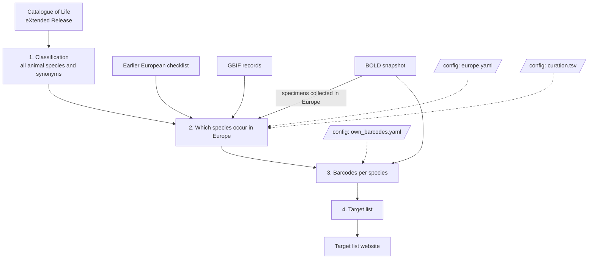

# How it works

The pipeline answers one question for every European animal species: is
there at least one public DNA barcode for it? It does so in four steps.

## Step 1: one classification for everything

All species names, from every source, are linked to one classification: the
[Catalogue of Life](https://www.catalogueoflife.org) (CoL). We use its
**eXtended Release**, which adds names from many more sources to the
expert-curated base release. The base release alone lacked about a quarter of
the European species in the earlier checklist, mostly beetles and mites.
Species that only the eXtended Release has are marked in the results.

The step keeps all animal species (not fossils) with their synonyms.
Subspecies are counted with their species throughout.

## Step 2: which species occur in Europe

"Europe" here is a political area, set in `config/europe.yaml`: the
countries of geographic Europe, plus Armenia, Georgia and Turkey, without
Russia and Azerbaijan. A species counts as European when at least one of
three sources says it occurs there:

- **The earlier European checklist**, compiled by hand for the previous gap
  list from national checklists, Fauna Europaea and other sources.
- **GBIF**: at least one record of the species in a European country, with
  coordinates, not from captivity or cultivation, and not a fossil.
  Species with records marked as introduced are flagged as possibly alien.
- **BOLD**: at least one specimen collected in a European country.

How many sources are needed is a setting (`min_sources`); it is 1 now.

Every name from every source is **matched to Catalogue of Life**, including
through synonyms, so that a species listed under an old name is still found.
Names the pipeline cannot match with certainty go to a review list for a
person to decide. See [Reviewing names](reviewing-names.md).

## Step 3: barcodes per species

From a snapshot of the public BOLD database, the pipeline counts for every
species the **barcode-compliant** sequences: COI-5P sequences of at least 500
bases. It counts those from anywhere in the world, and separately those from
specimens collected in Europe.

Barcodes are counted as **own** when they come from BGE projects (listed in
`config/own_barcodes.yaml`), and as **other** otherwise. A barcode filed in
BOLD under a synonym counts for the accepted species.

## Step 4: the target list

Every European species gets one row. A species without any compliant barcode
is a **gap**. The list is written in the layout the website expects, together
with a fuller table and a summary. See [Reading the results](results.md).

## Repeatability

Every run records exactly which data it used: the Catalogue of Life release
and its DOI, the version of the earlier checklist, the GBIF download and its
DOI, and the date of the BOLD snapshot. These are listed in
`data/output/summary.md`. Running again with the same versions and settings
gives the same list.
